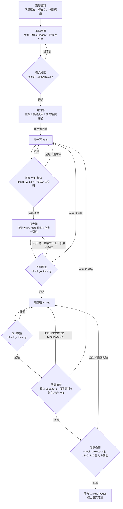
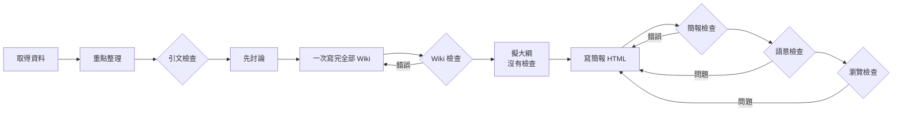

# JEPA LLM Wiki + 教學簡報（TAICA w10）

- **簡報**：https://mikoal.github.io/TAICA_w10/ （reveal.js；方向鍵換頁，按 `S` 開講者備註）
- **Wiki**：[wiki/index.md](wiki/index.md)（6 篇來源頁 + 9 個概念頁，每句都有逐字引文）
- **Wiki 規則（schema）**：[CLAUDE.md](CLAUDE.md)
- **時間序紀錄（討論、ingest、檢查、修正）**：[wiki/log.md](wiki/log.md)
- **檢查紀錄**：[logs/](logs/)（[run-1 總結](logs/run-1/SUMMARY.md)、[run-2 總結](logs/run-2/SUMMARY.md)）

## 流程（graph）

### run-2 之後的版本（目前）



### run-1 的版本（被修改前）



### 哪些步驟會重複？
| 迴圈 | 重複什麼 | 什麼時候停 |
|---|---|---|
| 重點整理 ⇄ 引文檢查 | 引文找不到就重新從原文挑句子 | 85 句全部找得到 |
| 寫 Wiki ⇄ Wiki 檢查 | **每寫完一頁**就檢查、修正 | `check_wiki.py` errors=0 |
| 擬大綱 ⇄ 大綱檢查 | 補但書、修數字、修引用 | `check_outline.py` errors=0 |
| 大綱／語意檢查 → 寫 Wiki | Wiki 缺資料或 Wiki 本身寫錯，就回到 Wiki 修 | 回頭邊 |
| 寫 HTML ⇄ 簡報／語意／瀏覽檢查 | 重寫該頁 | 三種檢查都通過 |

### 為什麼這樣設計？
- **確定性檢查放前面，語意檢查放最後**：程式檢查又快又便宜，可以一直重跑；語意檢查每次都要開新的 subagent，比較貴，所以只當最後一道關卡。
- **語意檢查用「沒看過前文」的 subagent**：寫的人會不自覺補上腦中的知識，看不出自己漏寫了什麼。檢查者只拿到簡報和 Wiki，才能判斷簡報是不是真的只靠 Wiki。
- **寫簡報只能讀 Wiki**：這樣「簡報 → Wiki → 原文」每一段都能檢查。Wiki 每句有逐字引文可以比對原文，簡報每頁有 `data-wiki` 可以比對 Wiki。
- **run-2 把檢查往前移**：見 [run-1 總結](logs/run-1/SUMMARY.md)。語意問題在 HTML 寫完後才被發現，每修一次就要重寫、重新語意檢查，所以把「但書」和「引用範圍」的檢查移到大綱；Wiki 的格式檢查也從「整批寫完」改成「每頁寫完」。

## 目錄
| 路徑 | 內容 |
|---|---|
| `wiki/` | LLM Wiki（`index.md`、`log.md`、`sources/`、`concepts/`） |
| `raw/SOURCES.md` | 原始資料清單（原文檔不放進 repo） |
| `work/takeaways/` | 討論前的每篇重點整理（subagent 產出） |
| `slides/outline.md` | 簡報大綱 |
| `index.html` | 簡報 |
| `scripts/` | 檢查程式；`tests/` 是它們的測試 |
| `logs/run-N/` | 每輪檢查的原始輸出與截圖 |
| `docs/superpowers/` | 設計文件與實作計畫 |

## 重跑檢查
```bash
python3 -m unittest discover tests
python3 scripts/check_wiki.py      # 需要本機 raw/（見 raw/SOURCES.md 下載）
python3 scripts/check_outline.py
python3 scripts/check_slides.py
npm install && node scripts/check_browser.mjs   # 需要 Chromium
```
