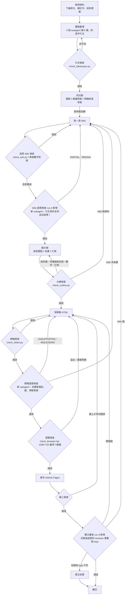

# 〈學校〉 〈學號〉 〈系級〉 〈姓名〉 JEPA

## 1. LLM Wiki 主題與簡介

**主題：JEPA（Joint-Embedding Predictive Architecture）**

JEPA 是 Yann LeCun 提出、Meta 實作的一種自監督學習架構。它的想法是：AI 不必像生成式模型那樣把被遮住的部分逐一像素補回來，只要在抽象的「表示」裡預測它。在 LeCun「讓機器學會 world model」的構想裡，JEPA 是解法的一個關鍵元素。

Wiki 照 Karpathy 的 LLM Wiki 做法建立：

- `raw/`：原始資料，不可修改。
- `wiki/`：AI 維護的 markdown 頁面，包含 `index.md` 目錄和 `log.md` 時間序紀錄。
- `CLAUDE.md`：規則檔，規定 AI 怎麼 ingest、怎麼查詢、怎麼 lint。

**Ingest 了 6 篇資料**（清單：[raw/SOURCES.md](https://github.com/MikoAL/TAICA_w10/blob/main/raw/SOURCES.md)）：

| 來源 | 在 Wiki 裡的角色 |
|---|---|
| Meta 部落格：LeCun 的 world model 構想（2022） | 為什麼需要 world model |
| Meta 部落格：I-JEPA（2023） | 白話入門 |
| I-JEPA 論文（CVPR 2023） | 主要範例 |
| V-JEPA 論文（2024） | 延伸到影片 |
| VICReg 論文（ICLR 2022） | collapse 與防法 |
| JEPA-Anything 論文（2026，v1 預印本） | 最新進展 |

**Wiki 的內容**：

- 6 個來源頁。
- 9 個概念頁：world model、自監督學習、三大流派、JEPA、像素 vs 表示、collapse、遮罩策略、怎麼看數字、正交預測分解。
- **來源內容的每個段落、條列項和表格列都附原文的逐字引文**，程式可以自動比對原文。
- AI 自己加的解釋一律標「（AI 補充）」。

### 先討論、後生成
- **選主題**：我原本想做電玩，後來拿了一篇 JEPA-Anything 論文問 AI 可不可以用。討論後放棄電玩，改做 JEPA，並把對象定為「TAICA 同學程度」。
- **生成之前**：5 個 subagent 讀 6 篇原文（其中一個讀兩篇 Meta 部落格），整理重點（85 句行首引文用程式驗證過）。AI 把 6 篇重點、讀到的矛盾、擬建的 15 個頁面和 5 個問題整理給我看。我同意 AI 的建議之後才開始寫 Wiki（同意是 00:53:14，第一個 Wiki 頁是 00:55:48 寫的）。
- 5 個問題是：主要範例選誰、數學放多深、要不要放「JEPA 輸在哪裡」、JEPA-Anything 講多深、LeCun 的六模組放多少。
- 完整的討論過程和我的原話記在 [wiki/log.md](https://github.com/MikoAL/TAICA_w10/blob/main/wiki/log.md)。

## 2. 連結
- **LLM Wiki**：https://github.com/MikoAL/TAICA_w10/blob/main/wiki/index.md
- **教學 HTML 簡報**：https://mikoal.github.io/TAICA_w10/ （方向鍵換頁；按 S 開講者備註）
- **GitHub Repository**：https://github.com/MikoAL/TAICA_w10
- 規則檔：[CLAUDE.md](https://github.com/MikoAL/TAICA_w10/blob/main/CLAUDE.md)；流程說明：[README.md](https://github.com/MikoAL/TAICA_w10/blob/main/README.md)

### 簡報的教學結構（16 頁）
為什麼（20 小時學開車）→ 自監督學習 → 三種流派 → JEPA 三個零件 → collapse → VICReg 三個項 → I-JEPA（主要範例）→ 證據：預測表示 vs 像素 → V-JEPA → 怎麼看數字 → JEPA-Anything → JEPA 輸在哪裡 → LeCun 大藍圖 → 帶走四句話 → 自我檢測（3 題，按鍵顯示答案）

**Wiki 和簡報的對應**：

- 每頁 `<section>` 都有 `data-wiki` 屬性，列出它引用的 Wiki 頁和段落。
- 頁尾有可點的「來源：Wiki › …」連結。
- `check_slides.py` 會檢查：引用的頁面和段落存在、頁尾有連結、簡報上的每個數字都出現在被引用的 Wiki 頁。

## 3. Loop / Graph 設計

**資訊怎麼流動**：原文 →（逐字引文）→ Wiki →（`data-wiki` 引用）→ 簡報。

- 規則是寫簡報時**只能讀 Wiki**，不能讀原文，也不能靠模型記憶，所以每一段都能檢查。但寫簡報的是同一個 AI 對話，之前讀過原文重點，所以這條靠檢查把關，不是靠隔離。
- Wiki → 原文：`check_wiki.py` 比對引文、檢查數字有沒有出現在引文裡；Wiki 語意檢查判斷引文是不是真的支持那句話。
- 簡報 → Wiki：`check_slides.py` 檢查引用和數字；語意檢查判斷內容有沒有超出 Wiki。

**哪些步驟會重複**：
- 重點整理 ⇄ 引文檢查
- 寫 Wiki ⇄ Wiki 檢查（每頁）
- Wiki 語意檢查 → 寫 Wiki（再走一次逐頁檢查）
- 擬大綱 ⇄ 大綱檢查
- 寫 HTML ⇄ 簡報檢查／語意檢查／瀏覽檢查
- 獨立審查 → 更正紀錄／寫 Wiki／寫 HTML
- 回頭邊：大綱或語意檢查發現 Wiki 缺資料、或 Wiki 本身寫錯時，回到寫 Wiki。
- **沒有實際走過的邊**：「引文檢查 → 重點整理」（第一次就 0 錯）、「大綱檢查 → 寫 Wiki」。其他回頭邊都走過，紀錄見 README。

**哪裡需要檢查或重新生成**：

- 確定性檢查：引文、數字、連結、引用、溢出。程式自動跑，一有錯就重寫那一頁。
- 語意檢查：有沒有漏但書、有沒有誇大、引文支不支持。交給一個**沒看過前文**的 subagent，不合格就重寫那一頁 Wiki 或 HTML。
- 獨立審查：紀錄和 logs／git 對不對得上。

**為什麼這樣設計**：
1. **便宜的檢查放前面、可以一直重跑；貴的放最後。** 程式檢查一秒跑完，語意檢查每次都要開一個新的 subagent。
2. **檢查者不能是寫的人。** 寫的人會不自覺用腦中的知識補上漏掉的東西。檢查者被指示只讀簡報和 Wiki，才看得出簡報有沒有超出 Wiki（prompt 存在 [logs/run-3/prompts](https://github.com/MikoAL/TAICA_w10/tree/main/logs/run-3/prompts)）。
3. **檢查要從源頭開始。** 簡報以 Wiki 為標準，所以 Wiki 要先以原文為標準檢查過語意；不然錯誤會一路傳下去。
4. **每一層都留下可比對的痕跡**：引文、`data-wiki`、`log.md`、`logs/`。這樣出錯時查得到是哪一層出的錯。

## 4. 實際執行紀錄

檢查輸出在 [logs/](https://github.com/MikoAL/TAICA_w10/tree/main/logs)（run-1 瀏覽檢查第 1 次的輸出沒有留下，其餘都在）。run-1 和 run-2 在 2026-11-23 00:32–01:18 做完，線上檢查 12:44–12:48，run-3 從 16:08 開始；git commit 時間可以對照。

### run-1（第一次完整跑）
| 節點 | 第一次結果 | 修到通過 |
|---|---|---|
| 取得資料 | 6 篇中 1 篇失敗：LeCun 立場論文在 OpenReview，回 403 人機驗證 | 改用 Meta 2022 年介紹同一構想的文章 |
| 重點整理 | 85 句引文，0 句找不到 | — |
| **寫 Wiki** | **49 errors**：數字不在引文 32、未引用段落 14、引文找不到 3 | 4 次 |
| 表格數字對照（AI 逐列對照原文） | 列出的 11 個數字都對，但抓到 **1 個敘述錯誤**：Wiki 寫 I-JEPA 表 7「同樣設定只改目標」，原文表格顯示兩組 epoch 是 500 vs 800 | 1 次 |
| 簡報檢查 | 1 error（誤報：式子的上下標 2、2 被當成「22」） | 2 次 |
| **語意檢查** | 14 頁中 **4 UNSUPPORTED、2 MISLEADING** | 第 2 次仍有 2 UNSUPPORTED、1 MISLEADING |
| 瀏覽檢查 | 封面溢出；截圖另外看出背景色沒套用、predictor 被畫成箭頭 | 2 次 |

完整整理：[logs/run-1/SUMMARY.md](https://github.com/MikoAL/TAICA_w10/blob/main/logs/run-1/SUMMARY.md)

**實際抓到的錯誤例子**：
- V-JEPA 論文寫「2 million videos」，Wiki 寫成「200 萬支」。數字檢查報錯，改成保留原文數字。
- I-JEPA 的 PDF 是雙欄排版，有 3 句引文在文字檔裡被另一欄的字插進中間，程式比對不到。改成拆成兩句單欄引文。
- 簡報寫「預測表示 66.9 vs 像素 40.7」，卻沒寫 Wiki「注意」段落的但書：這只是一組消融實驗，而且 V-JEPA 微調時差距很小。語意檢查判 MISLEADING。
- 簡報標題寫「最大的陷阱：collapse」，但 Wiki 只說它是「難點」。這是 Wiki 沒有的最高級說法。

### run-2（修改流程後再跑一次）
新增一頁「VICReg 的三個項」，照新流程走完，並把全部檢查重跑一次。
| 節點 | 結果 |
|---|---|
| 用新的大綱檢查回頭檢查 run-1 的大綱 | 8 列缺但書，但 run-1 大綱本來沒有這一欄，所以必然報錯，不能證明有效（見反思） |
| 大綱檢查 | 第 1 次 2 errors（1 個真的漏但書、1 個誤報）→ 第 2 次 0 |
| 簡報檢查 | 第 1 次就 0 errors |
| 語意檢查（整份） | **12 / 2 / 1**（SUPPORTED / UNSUPPORTED / MISLEADING）；run-1 第 1 次 8 / 4 / 2、第 2 次 11 / 2 / 1 |
| 語意複查 | 修過的頁最後都通過（複查有告訴檢查者上次的問題，不是盲測）；過程中發現大綱檢查的漏洞（見反思） |
| 瀏覽檢查／Wiki 檢查／28 個單元測試 | 全部通過 |
| **線上瀏覽檢查**（GitHub Pages 實際網址） | 第 1 次：16 頁 0 溢出，但有 1 個 console 404。原因是瀏覽器自動抓 `/favicon.ico`，本機用 `file://` 開不會出現 → 內嵌 icon 後重新發布，第 2 次 0 錯誤；頁尾 15 個 Wiki 連結全部 HTTP 200 |

完整整理：[logs/run-2/SUMMARY.md](https://github.com/MikoAL/TAICA_w10/blob/main/logs/run-2/SUMMARY.md)

### run-3（獨立審查 → 更正紀錄 → 補 Wiki 語意檢查）
run-2 全部通過後，找一個沒看過過程的 reviewer 看整個 repo。它找到紀錄錯誤和 Wiki 語意錯誤，所以再跑一輪：Wiki → 大綱 → 簡報 → 檢查。
| 節點 | 結果 |
|---|---|
| 獨立審查 | 4 個嚴重（都在紀錄：時間、錯誤分類、兩個因果結論）＋ 5 個重要問題，逐項查證後處理 |
| 大綱檢查加新規則 | 舊大綱 4 errors（但書推給別頁）→ 0 |
| **Wiki 語意檢查**（15 頁、148 項） | **128 SUPPORTED／20 PARTIAL／0 WRONG**；查證後 18 項照原文改、2 項是檢查者看漏 |
| Wiki 語意複查（只看改過的） | 約 48／2／0 → 2 項已修 |
| **簡報語意檢查**（含備註、圖、測驗） | 第 1 次 **9／1／5** → 第 2 次 14／0／1 → 第 3 次（第 11、14、16 頁）1／1／1 → 第 4 次（第 14、16 頁）2／0／0 |
| 瀏覽檢查 | 改字後 3 頁溢出 → 修完 0 |
| 程式檢查 | Wiki／大綱／簡報 errors=0，32 個測試全過 |
| 線上檢查 | 17:45 對 GitHub Pages：16 頁 0 errors，簡報和本文件裡 26 個 GitHub 連結全部 HTTP 200 |

完整整理：[logs/run-3/SUMMARY.md](https://github.com/MikoAL/TAICA_w10/blob/main/logs/run-3/SUMMARY.md)；審查原文：[independent-review.md](https://github.com/MikoAL/TAICA_w10/blob/main/logs/run-3/independent-review.md)

## 5. 反思

**哪一個節點最常出錯？**

看程式報的數量，是**寫 Wiki**：第一次跑有 49 個錯誤。最多的是數字（32 個「數字不在引文裡」，一部分是條列編號和數學式的誤報），其次是 14 個沒有引用的段落，多半是 AI 把自己的解釋混進來源內容。

但程式報的 0 errors 不代表沒錯。修到 0 errors 之後，獨立審查在 Wiki 找到 9 類「引文存在，但沒有完整支持那句話」（漏掉「可以說」、「+21 分」沒寫是和影像模型比、把「一個關鍵元素」寫成「核心」）。修完這些，Wiki 語意檢查又找到 20 項（漏掉「可能」、把「一個關鍵差別」寫成「最大的差別」）。所以最容易出錯的節點還是**寫 Wiki**，而且最嚴重的那種錯，程式抓不到。

**發現問題後，把檢查往前移到哪一個步驟？**

1. **run-2：把一部分檢查從「HTML 寫完」移到「擬大綱」**（`check_outline.py`）：但書要填、數字和引用要存在。
2. **run-3：再往前移到「寫完 Wiki」**：新增 Wiki 語意檢查，逐項問「引文真的支持這句話嗎？」。
3. **Wiki 的格式檢查從「整批寫完」移到「每寫完一頁」**。run-2 沒有改 Wiki 頁，run-3 才第一次實際跑到。
4. **表格數字在寫 Wiki 時就逐列對照原文。** 程式只能確認數字在原文某處，不能確認敘述對不對（表 7 的 epoch 錯誤就是對照時才發現的）。

**為什麼要移到 Wiki，而不是只把簡報檢查做得更嚴？**

因為**檢查者會繼承標準的錯誤**。最清楚的例子：Wiki 把 I-JEPA 寫成用 stop-gradient，但原文只說 I-JEPA 用不對稱架構和 EMA。run-1 的測驗答案原本寫「I-JEPA 用 EMA（V-JEPA 再加 stop-gradient）」，比 Wiki 正確；簡報語意檢查以 Wiki 為標準，判它 UNSUPPORTED，結果被改成**錯的**，之後 run-2 的檢查也都通過。簡報檢查得再嚴，Wiki 錯就沒用。

**有沒有因此修改 workflow / graph？**

有，改了兩次：

- run-1 → run-2：加「大綱檢查」節點、Wiki 改逐頁檢查。
- run-2 → run-3：加「Wiki 語意檢查」和「獨立審查」兩個節點；簡報語意檢查擴大到講者備註、圖和測驗答案；大綱檢查加上「但書不能推給別頁」（用新規則檢查舊大綱，馬上抓到 4 列）。

**這些修改有效嗎？**

原本這份文件寫「run-2 證明大綱檢查有效，語意問題從 6 頁降到 3 頁」。獨立審查指出這個結論不成立，對照紀錄後確實如此：

- 加大綱檢查**之前**，run-1 第 2 次就已經是 3 頁有問題；6 → 3 是 run-1 改簡報造成的。
- 用大綱檢查回頭檢查 run-1 大綱，8 列報錯是必然的，因為當時根本沒有「但書」欄；其中 5 列當時的語意檢查是 SUPPORTED。
- 語意檢查本身不穩定：第 2 頁有兩句沒改，run-1 第 2 次判 SUPPORTED，run-2 判 UNSUPPORTED。所以各次的頁數不能直接比。

能確定的比較少：大綱檢查抓到 1 個真的漏但書，也放行過 1 個（Hopper，大綱寫「放到別頁」）；Wiki 語意檢查找到 20 項，查證後 18 項成立、2 項是檢查者看漏。

**檢查本身也需要被檢查，紀錄也是。**

- 檢查程式的誤報和漏洞：條列編號和 `$$` 數學式被當數字、找不到大綱表格時默默回報 0 列、但書推給別頁會放行。這些都修了，並補了測試，目前共 32 個。
- 獨立審查找到的最嚴重問題不在簡報，在**紀錄**：AI 寫 `log.md` 時，時間是估的、錯誤分類憑記憶寫、因果說得太滿。程式檢查完全不看這些。更正說明在 `log.md` 最後和 run-1、run-2 的 SUMMARY 開頭。
- 還沒解決的：瀏覽檢查只量垂直溢出；「只能讀某些檔案」只是 prompt 的指示；大綱檢查不判斷但書的內容對不對。
