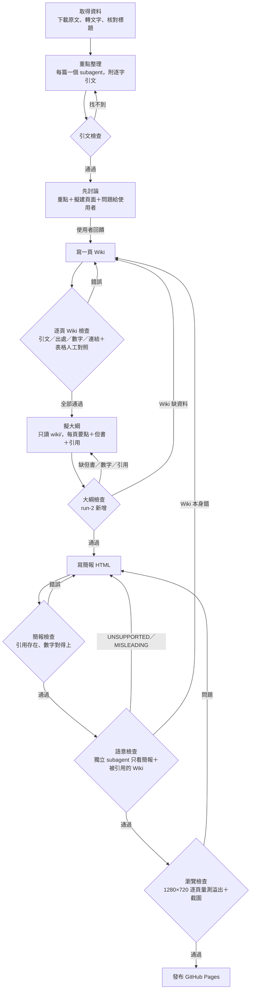

# 〈學校〉 〈學號〉 〈系級〉 〈姓名〉 JEPA

## 1. LLM Wiki 主題與簡介

**主題：JEPA（Joint-Embedding Predictive Architecture）**

JEPA 是 Yann LeCun 提出、Meta 實作的一種自監督學習架構。它的想法是：AI 不必像生成式模型那樣預測下一張圖的每個像素，只要在抽象的「表示」裡預測接下來會發生什麼。這是 LeCun「讓機器學會 world model」構想的核心。

Wiki 照 Karpathy 的 LLM Wiki 做法建立：

- `raw/`：原始資料，不可修改。
- `wiki/`：AI 維護的 markdown 頁面，包含 `index.md` 目錄和 `log.md` 時間序紀錄。
- `CLAUDE.md`：規則檔，規定 AI 怎麼 ingest、怎麼查詢、怎麼 lint。

**Ingest 了 6 篇資料**（清單：[raw/SOURCES.md](https://github.com/MikoAL/TAICA_w10/blob/main/raw/SOURCES.md)）：

| 來源 | 在 Wiki 裡的角色 |
|---|---|
| Meta 部落格：LeCun 的 world model 構想（2022） | 為什麼需要 world model |
| Meta 部落格：I-JEPA（2023） | 白話入門 |
| I-JEPA 論文（CVPR 2023） | 主要範例 |
| V-JEPA 論文（2024） | 延伸到影片 |
| VICReg 論文（ICLR 2022） | collapse 與防法 |
| JEPA-Anything 論文（2026，v1 預印本） | 最新進展 |

**Wiki 的內容**：

- 6 個來源頁。
- 9 個概念頁：world model、自監督學習、三大流派、JEPA、像素 vs 表示、collapse、遮罩策略、怎麼看數字、正交預測分解。
- **每一句都附原文的逐字引文**，程式可以自動比對原文。
- AI 自己加的解釋一律標「（AI 補充）」。

### 先討論、後生成
- **選主題**：我原本想做電玩，後來拿了一篇 JEPA-Anything 論文問 AI 可不可以用。討論後放棄電玩，改做 JEPA，並把對象定為「TAICA 同學程度」。
- **生成之前**：6 個 subagent 各讀一篇原文全文，整理重點（85 句引文全部用程式驗證過）。AI 把 6 篇重點、讀到的矛盾、擬建的 15 個頁面和 5 個問題整理給我看。我同意 AI 的建議之後才開始寫 Wiki。
- 5 個問題是：主要範例選誰、數學放多深、要不要放「JEPA 輸在哪裡」、JEPA-Anything 講多深、LeCun 的六模組放多少。
- 完整的討論過程和我的原話記在 [wiki/log.md](https://github.com/MikoAL/TAICA_w10/blob/main/wiki/log.md)。

## 2. 連結
- **LLM Wiki**：https://github.com/MikoAL/TAICA_w10/blob/main/wiki/index.md
- **教學 HTML 簡報**：https://mikoal.github.io/TAICA_w10/ （方向鍵換頁；按 S 開講者備註）
- **GitHub Repository**：https://github.com/MikoAL/TAICA_w10
- 規則檔：[CLAUDE.md](https://github.com/MikoAL/TAICA_w10/blob/main/CLAUDE.md)；流程說明：[README.md](https://github.com/MikoAL/TAICA_w10/blob/main/README.md)

### 簡報的教學結構（16 頁）
為什麼（20 小時學開車）→ 自監督學習 → 三種「猜」法 → JEPA 三個零件 → collapse → VICReg 三個項 → I-JEPA（主要範例）→ 證據：預測表示 vs 像素 → V-JEPA → 怎麼看數字 → JEPA-Anything → JEPA 輸在哪裡 → LeCun 大藍圖 → 帶走四句話 → 自我檢測（3 題，按鍵顯示答案）

**Wiki 和簡報的對應**：

- 每頁 `<section>` 都有 `data-wiki` 屬性，列出它引用的 Wiki 頁和段落。
- 頁尾有可點的「來源：Wiki › …」連結。
- `check_slides.py` 會檢查：引用的頁面和段落存在、頁尾有連結、簡報上的每個數字都出現在被引用的 Wiki 頁。

## 3. Loop / Graph 設計

**資訊怎麼流動**：原文 →（逐字引文）→ Wiki →（`data-wiki` 引用）→ 簡報。

- 寫簡報時**只能讀 Wiki**，不能讀原文，也不能靠模型記憶。所以每一段都能檢查。
- Wiki → 原文：`check_wiki.py` 逐句比對引文、檢查數字有沒有出現在引文裡。
- 簡報 → Wiki：`check_slides.py` 檢查引用和數字；語意檢查判斷內容有沒有超出 Wiki。

**哪些步驟會重複**：
- 重點整理 ⇄ 引文檢查
- 寫 Wiki ⇄ Wiki 檢查（每頁）
- 擬大綱 ⇄ 大綱檢查
- 寫 HTML ⇄ 簡報檢查／語意檢查／瀏覽檢查
- 兩條「回頭邊」：大綱或語意檢查發現 Wiki 缺資料、或 Wiki 本身寫錯時，回到寫 Wiki。

**哪裡需要檢查或重新生成**：

- 確定性檢查：引文、數字、連結、引用、溢出。程式自動跑，一有錯就重寫那一頁。
- 語意檢查：有沒有漏但書、有沒有誇大。交給一個**沒看過前文**的 subagent，不合格就重寫那一頁 HTML。

**為什麼這樣設計**：
1. **便宜的檢查放前面、可以一直重跑；貴的放最後。** 程式檢查一秒跑完，語意檢查每次都要開一個新的 subagent。
2. **檢查者不能是寫的人。** 寫的人會不自覺用腦中的知識補上漏掉的東西。檢查者只拿到簡報和 Wiki，才看得出簡報有沒有超出 Wiki。
3. **每一層都留下可比對的痕跡**：引文、`data-wiki`、`log.md`、`logs/`。這樣出錯時查得到是哪一層出的錯。

## 4. 實際執行紀錄

所有原始輸出都在 [logs/](https://github.com/MikoAL/TAICA_w10/tree/main/logs)。

### run-1（第一次完整跑）
| 節點 | 第一次結果 | 修到通過 |
|---|---|---|
| 取得資料 | 6 篇中 1 篇失敗：LeCun 立場論文在 OpenReview，回 403 人機驗證 | 改用 Meta 2022 年介紹同一構想的文章 |
| 重點整理 | 85 句引文，0 句找不到 | — |
| **寫 Wiki** | **49 errors**：未引用段落 18、數字不在引文 27、引文找不到 3、其他 1 | 4 次 |
| 表格人工對照 | 19 個數字都對，但抓到 **1 個敘述錯誤**：Wiki 寫 I-JEPA 表 7「同樣設定只改目標」，原文表格顯示兩組 epoch 是 500 vs 800 | 1 次 |
| 簡報檢查 | 1 error（誤報：式子的上下標 2、2 被當成「22」） | 2 次 |
| **語意檢查** | 14 頁中 **4 UNSUPPORTED、2 MISLEADING** | 第 2 次仍有 2 UNSUPPORTED、1 MISLEADING |
| 瀏覽檢查 | 封面溢出；截圖另外看出背景色沒套用、predictor 被畫成箭頭 | 2 次 |

完整整理：[logs/run-1/SUMMARY.md](https://github.com/MikoAL/TAICA_w10/blob/main/logs/run-1/SUMMARY.md)

**實際抓到的錯誤例子**：
- 部落格寫「2 million videos」，Wiki 寫成「200 萬支」。數字檢查報錯，改成保留原文數字。
- I-JEPA 的 PDF 是雙欄排版，有 3 句引文在文字檔裡被另一欄的字插進中間，程式比對不到。改成拆成兩句單欄引文。
- 簡報寫「預測表示 66.9 vs 像素 40.7」，卻沒寫 Wiki「注意」段落的但書：這只是一組消融實驗，而且 V-JEPA 微調時差距很小。語意檢查判 MISLEADING。
- 簡報標題寫「最大的陷阱：collapse」，但 Wiki 只說它是「難點」。這是 Wiki 沒有的最高級說法。

### run-2（修改流程後再跑一次）
新增一頁「VICReg 的三個項」，照新流程走完，並把全部檢查重跑一次。
| 節點 | 結果 |
|---|---|
| 用新的大綱檢查回頭檢查 run-1 的大綱 | 8 列缺但書。run-1 語意問題中有 3 頁屬於這類，**在大綱階段就能攔下** |
| 大綱檢查 | 第 1 次 2 errors（1 個真的漏但書、1 個誤報）→ 第 2 次 0 |
| 簡報檢查 | 第 1 次就 0 errors |
| 語意檢查（整份） | **12 / 2 / 1**（SUPPORTED / UNSUPPORTED / MISLEADING），run-1 第 1 次是 8 / 4 / 2 |
| 語意複查 | 修過的頁全部通過；過程中發現大綱檢查的漏洞（見反思） |
| 瀏覽檢查／Wiki 檢查／28 個單元測試 | 全部通過 |

完整整理：[logs/run-2/SUMMARY.md](https://github.com/MikoAL/TAICA_w10/blob/main/logs/run-2/SUMMARY.md)

## 5. 反思

**哪一個節點最常出錯？**

看數量，是**寫 Wiki**：第一次跑就有 49 個錯誤。最大宗是 AI 把自己的解釋、比喻和來源事實混在一起寫，看不出哪句有出處。其次是數字：單位換算、表格數字沒標表號、引的句子裡根本沒有那個數字。

但這些都是程式抓得到的。真正麻煩的是**寫簡報**這一步：錯誤數量少，但全是語意問題，確定性檢查全部漏掉：

- 漏掉 Wiki 寫好的但書。
- 把「論文認為」寫成事實。
- 加上 Wiki 沒有的最高級說法。
- 圖和文字互相矛盾。

這些問題要等 HTML 寫完、跑語意檢查才會被發現。每修一次就要重寫 HTML，再派一個新的 subagent 檢查一次。

**發現問題後，把檢查往前移到哪一個步驟？**

1. **語意的一部分移到「擬大綱」**：新增 `check_outline.py`，在寫 HTML 之前執行。
   - 大綱每頁多一欄「但書」。只要引用的 Wiki 頁有「注意」段落，這欄就必填。
   - 大綱裡的數字必須在引用頁找得到。
   - 用它回頭檢查 run-1 的大綱，run-1 語意問題中有 3 頁在大綱階段就能攔下。
2. **Wiki 檢查從「整批寫完」移到「每寫完一頁」**。run-1 是 15 頁寫完才第一次檢查，同一種錯誤在每一頁重複出現。
3. **表格數字的人工對照移到寫 Wiki 的當下**。程式只能確認數字出現在原文某處，不能確認敘述對不對：表 7 的 epoch 錯誤就是人工對照才抓到的。

**有沒有因此修改 workflow / graph？為什麼？**

有。graph 多了「大綱檢查」節點和一條「大綱 → 寫 Wiki」的回頭邊，Wiki 的檢查迴圈改成逐頁。規則檔 `CLAUDE.md` 也加了幾條新規則：

- AI 補充要標「（AI 補充）」。
- 簡報不能有 Wiki 沒有的最高級說法。
- 但書不能用「放到別頁」來豁免。

為什麼：**錯誤越晚被發現，修起來越貴。** 在大綱裡補一句但書只要幾秒；在 HTML 寫完後才發現，要改 HTML、重跑簡報檢查、重派語意檢查。

run-2 證明這個修改有效，語意問題從 6 頁降到 3 頁，但也證明它不是萬能：

- 剩下的 3 頁都是措辭和圖的問題，只有語意檢查抓得到，所以語意檢查保留為最後一道關卡。
- run-2 也找到新檢查本身的漏洞：我在大綱寫「Hopper 的但書放到別頁」，`check_outline.py` 把它當成合格的理由放行，語意檢查卻判 MISLEADING。這條規則目前寫在 `CLAUDE.md`，靠語意檢查把關，程式還沒擋。

**檢查本身也需要被檢查**。過程中遇到的檢查程式誤報和漏洞：

- **條列編號「1.」、`$$` 數學式被當成數字**：修改程式，補了測試。
- **表格數字原本只給警告**：改成「至少要出現在原文」，補了測試。
- **找不到大綱表格時默默回報 0 列**：改成報錯，補了測試。
- **式子的上下標黏成「22」**：改了簡報的寫法，程式沒改。
- **「放到別頁」的但書豁免**：目前只寫成規則，靠語意檢查把關。

目前共 28 個單元測試。
